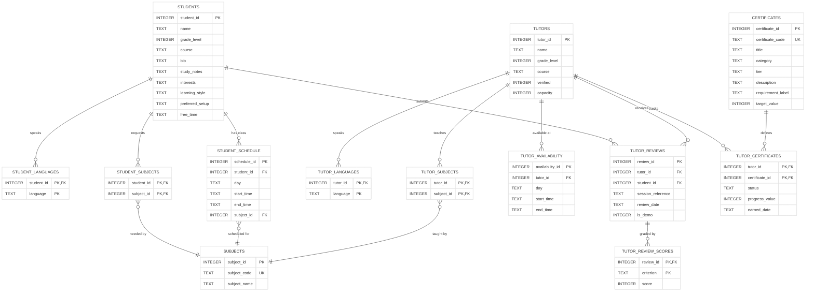

# TUGMA

> Tutor-student Unified Graph-based Matching Approach

## Overview

## Problem

## Objectives

## Discrete Structures Concepts

### Set Theory
### Predicate Logic
### Relations
### Graph Theory
### Algorithms

## System Architecture
```
tugma/
│
├── app.py
├── requirements.txt
├── README.md
├── .gitignore
│
├── assets/
│
├── database/
│   ├── schema.sql
│   └── seed.sql
│
├── docs/
│    ├── mathematical_model.md
│    ├── database_schema.md
│    └── architecture.md
│
├── src/
│   ├── database.py
│   ├── sets.py
│   ├── logic.py
│   ├── relations.py
│   ├── graph.py
│   ├── matching.py
│   ├── scheduling.py
│   └── visualization.py
│
└── tests/
    ├── test_logic.py
    ├── test_matching.py
    └── test_scheduling.py
```

## Features

## Technology Stack

## Installation

## Running the Application

## Database

### Entity Relationship Diagram


## Testing

## Project Structure

## Limitations

## Future Improvements

## License
## Tutor profile, teaching ratings, and certificates

The signed-in member can open **Profile** from the top-right control. Tutor profiles
show academic information, tutoring subjects and availability, criterion-level
teaching ratings, and earned or in-progress certificates. Rating aggregates and
certificate progress are read by `services/profile_service.py`; SQLite access is
provided by `src/database.py`.

The profile schema is included in `database/schema.sql` and its demonstration
records are included in `database/seed.sql`. Existing databases receive the same
additive changes through migration version 4. The seeded tutor reviews are clearly
identified as demonstration data (`is_demo = 1`) and are not genuine student
feedback. Teaching ratings and certificates are display-only and do not affect
the compatibility relation, graph, tutor capacity, or matching algorithm.
