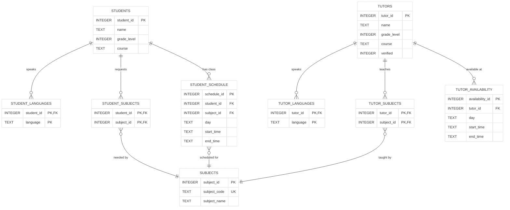

# TUGMA Database Schema

## Entity Relationship Diagram

## Tables

## Primary Keys

## Foreign Keys

## Relationships

## Normalization
## Tutor profile extensions (schema version 4)

- `tutor_reviews`: one sample or submitted review associated with a tutor and student.
  `session_reference` prevents duplicate reviews for the same tutor/session reference;
  `is_demo` identifies seeded demonstration records.
- `tutor_review_scores`: one 1–5 score per review and teaching criterion.
- `certificates`: certificate catalog, category, optional tier, requirement text, and target.
- `tutor_certificates`: tutor-specific earned/in-progress state, progress count, and earned date.

The profile tables are independent of the matching tables. Their values do not
participate in compatibility predicates or capacity-constrained matching.
